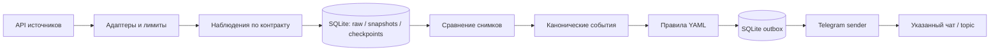

# Архитектура MVP

Статус на 30 октября 2026: P1 реализован — fixture replay, SQLite, detector, правила, dry-run, CLI и Docker. Live API и Telegram sender ещё не реализованы.

P1 использует Python, JSON Schema, PyYAML и стандартный sqlite3; версии заданы в `pyproject.toml`/`uv.lock`. Live polling позже добавит HTTP-клиент и scheduler; P1 выполняет конечный JSONL replay без сети. Один экземпляр worker в одном контейнере, WAL, постоянный volume `/data`. Дублирующий экземпляр с тем же state path отклоняется блокировкой. Горизонтальное выполнение — отдельное расширение.

## Границы модулей

| Модуль | Ответственность |
| --- | --- |
| Provider adapter | `capabilities()`, `fetch(checkpoint, budget) -> FetchBatch`: raw, observations, next checkpoint, next poll; преобразование единиц и времён |
| Ingestion | Проверка схемы и семантики, карантин ошибок, сохранение исходного ответа и его SHA-256 |
| Detector | Baseline, сравнение в пределах одного источника и субъекта, версии состояния и доменные события |
| Rules | Выбор событий по источнику, серии/контракту, возрасту и порогу |
| Outbox | Сохранённые задания доставки, повторные попытки и terminal failures |
| Telegram | Шаблоны на русском, экранирование текста источника, `sendMessage`, topic ID |
| CLI | `replay`, `validate-config`, `status`, `health` реализованы; live `run` и `outbox retry` запланированы |

Адаптер декларирует actual, forecast, revisions, scenario probability, origin прогноза, вид задержки и ограничения доступа. Эти возможности подтверждаются fixtures и live read-only проверкой перед объявлением адаптера рабочим. Неподдерживаемое активное правило — ошибка конфигурации; другие источники продолжают работать при временном отказе API.

## Данные и транзакции

Планируемые таблицы: `raw_responses`, `observations`, `subject_state`, `provider_checkpoints`, `events`, `subscriptions`, `outbox`, `quarantine`. Таблицы создаёт migration v1 в `src/macro_event_alerts/storage.py`. Сохранение принятого наблюдения, версии состояния, событий, outbox и курсора образует одну транзакцию. Raw можно сохранять заранее, но checkpoint продвигается после commit. Crash до commit допускает безопасное повторное чтение.

`subject_key` вычисляется по правилам [контракта событий](../.archcore/events.spec.md); `state_version` увеличивается при принятом изменении значений. `event_id` создаётся один раз на переход, затем хранится. Повтор запроса не создаёт новый переход, а A→B→A остаются разными переходами. Порядок определяется монотонной ревизией провайдера или source timestamp. Если их нет, сравниваются последовательно полученные снимки с пометкой неизвестного времени публикации; исторические запросы отдельно от live polling.

Для оконного правила outbox сохраняет неизменяемый evaluation context: опорный/current snapshot ID и времена, границы окна, before/after, delta_pp и версию правила. Например, 55→64→75% даёт событие последнего перехода +11 п.п., но алерт за окно показывает +20 п.п. Renderer использует сохранённый context, а не пересчитывает окно во время отправки. Cooldown ограничивает повторные уведомления правила; принятые события продолжают сохраняться.

Схемы задают форму данных. Сравнение состояний, расчёты Decimal, порядок снимков, соответствие ключей, возможности источников и freshness проверяет код следующего этапа. Скрипт проверки проверяет опубликованные контракты и примеры, а pytest проверяет переходы runtime, окна и транзакции. Статические инварианты разделяются через `src/macro_event_alerts/validation.py`.

## Планируемый Docker runtime

`Dockerfile` и `compose.yaml` запускают replay worker. CLI `replay`, `validate-config`, `status` и `health` реализованы; `run` live polling и `outbox retry` Telegram остаются будущими командами. Образ работает без root; конфигурация монтируется read-only, состояние хранится в volume, токен берётся из окружения. Остановка завершает текущую транзакцию и оставляет неотправленные записи в outbox. SQLite использует user_version=1; неизвестная версия отклоняется. Пока реализована только начальная миграция; backup перед будущей несовместимой миграцией входит в последующие этапы. Retention raw и snapshots задаётся конфигурацией после измерения размера данных; схема и события не удаляются раньше требуемого окна сравнения.

Health различает состояние процесса, последнюю успешную загрузку каждого источника, давность данных и возраст outbox. Логи содержат event/provider/rule ID; токены и полные Telegram URL с токеном исключаются. Ошибки источника имеют отдельный канал состояния и cooldown; непрерывный отказ не порождает алерт на каждом опросе.

## Отправка и сообщение

Сообщение содержит показатель/сценарий, период, факт/ожидание/предыдущее либо изменение, единицы, источник и ссылку, время наблюдения и известную задержку. Неизвестный прогноз обозначается «нет данных». Для рыночной цены пишется «цена исхода на Polymarket», для CME — «вероятность по FedWatch». Общего утверждения «75% трейдеров считают» нет.

Доставка имеет семантику at-least-once. После timeout с неизвестным результатом повтор может продублировать сообщение: Telegram Bot API не предоставляет идемпотентный ключ для `sendMessage`. Правила очереди — в [контракте доставки](../.archcore/telegram-delivery.spec.md).

Сервис читает данные и отправляет уведомления. Сделки, торговые ключи, автоматический прогноз цены золота и LLM в MVP не входят.

P1 dry-run сохраняет message_text/evaluation context до commit и переводит pending в dry_run после stdout. Авария между stdout и отметкой допускает повтор stdout, но не новое логическое событие. Health P1 проверяет схему и quick_check SQLite; метрики live source freshness и Telegram queue age относятся к следующим этапам.
